# Hydra Architecture

## Overview

Hydra is a persistent job processing system built around three independent runtime subsystems:

1. **Storage** — the source of truth.
2. **Scheduler** — transforms recurring schedules into executable jobs.
3. **Worker Pool** — executes jobs.

The Queue API acts as the single public entry point and coordinates all interactions between these components.

Both the Scheduler and Worker Pool are designed as **idle-first actors**. They remain dormant when no work exists and are activated through lightweight signals whenever new work arrives.

# Core Components

## Queue

The Queue acts as a facade.

Responsibilities:

- Accept jobs.
- Accept recurring schedules.
- Register workers.
- Control queue lifecycle.
- Expose metrics and statistics.

The Queue never executes jobs directly.

---

## Storage

Storage is the system of record.

Responsibilities:

- Persist jobs.
- Persist schedules.
- Persist execution state.
- Persist leases.
- Support crash recovery.

Implementations:

- Memory (default when no storage is configured; for tests only, nothing survives a restart)
- SQLite (single instance)
- Redis, Valkey, Dragonfly (single instance or several instances sharing it; Lua scripts declare every key they touch, as Dragonfly requires)
- PostgreSQL (single instance or several sharing it; `FOR UPDATE SKIP LOCKED` job claims)

`cmd/hydra-scheduler` compiles in one store per build tag
(`sqlite`, `redis`, `postgres`), so each released binary and
image carries a single store.

Finished and cancelled schedules, and completed jobs, are kept
as history. Each implementation indexes by status so that the
hot paths (loading active schedules, claiming ready jobs,
finding expired leases) never scan the history.

All runtime state can be reconstructed from storage.

---

## Scheduler

The Scheduler transforms schedules into executable jobs.

Responsibilities:

- Track upcoming schedule occurrences.
- Generate jobs.
- Update schedule state.
- Reinsert recurring schedules.

The Scheduler never executes jobs.

The Scheduler never holds full schedule objects in memory, and
holds entries only for the schedules due within its time window
(`ScheduleWindow`), among the shards its instance owns.

---

## Dispatcher

The Dispatcher bridges storage and workers.

Responsibilities:

- Claim jobs.
- Acquire leases.
- Batch loading.
- Recover expired leases.
- Feed jobs into worker pools.

The Dispatcher is responsible for ownership and locking.

---

## Worker Pool

The Worker Pool executes jobs.

Responsibilities:

- Receive claimed jobs.
- Execute handlers.
- ACK completed jobs.
- NACK failed jobs.
- Scale worker count.

The Worker Pool never performs scheduling.

---

# Public API

```go
type Producer interface {
	Submit(
		ctx context.Context,
		queue QueueName,
		job Job,
	) error

	RemoveJob(
		ctx context.Context,
		queue QueueName,
		jobID string,
	) error

	UpsertSchedule(
		ctx context.Context,
		queue QueueName,
		schedule Schedule,
	) error

	RemoveSchedule(
		ctx context.Context,
		queue QueueName,
		scheduleID string,
	) error

	PauseSchedule(
		ctx context.Context,
		queue QueueName,
		scheduleID string,
	) error

	ResumeSchedule(
		ctx context.Context,
		queue QueueName,
		scheduleID string,
	) error
}

type Consumer interface {
	Handle(queue QueueName, worker Worker)
}

type Queue interface {
	Producer
	Consumer

	Start(ctx context.Context) error
	Stop(ctx context.Context) error

	Pause(ctx context.Context, queue QueueName) error
	Resume(ctx context.Context, queue QueueName) error

	Stats(ctx context.Context) (StatsSnapshot, error)

	Inspector
}

// Inspector works without Start, e.g. from an admin command.
type Inspector interface {
	GetSchedule(ctx context.Context, scheduleID string) (*JobSchedule, error)
	ListSchedules(ctx context.Context, query ScheduleQuery) ([]*JobSchedule, error) // includes history
	ListJobs(ctx context.Context, query JobQuery) ([]*Job, error)                  // a schedule's occurrences
	ListDLQ(ctx context.Context, queue QueueName) ([]DeadLetter, error)
	RequeueDLQ(ctx context.Context, jobID string) error
}
```

---

# High-Level Architecture

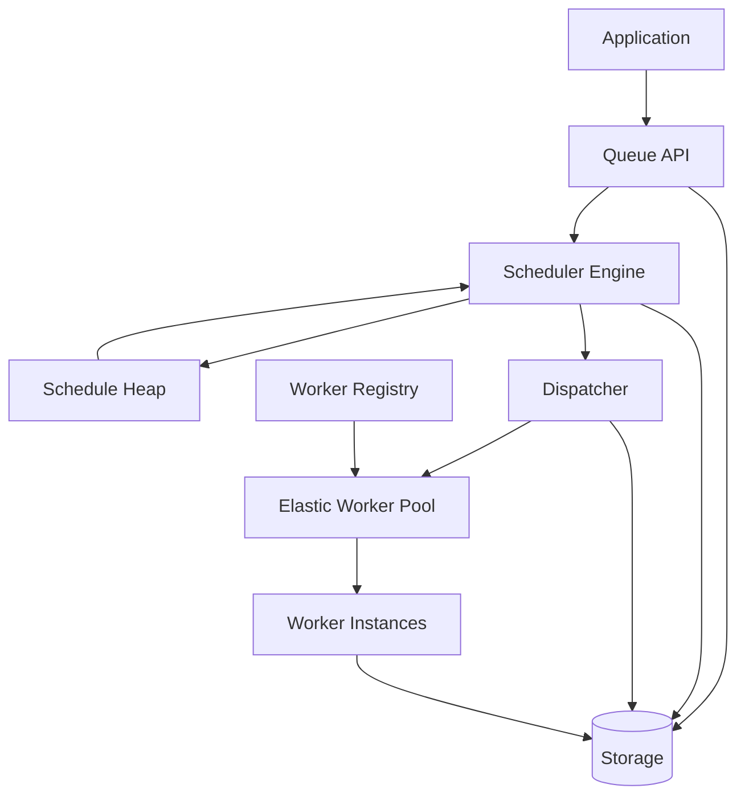

---

# Job Lifecycle

Direct jobs bypass the scheduler entirely.

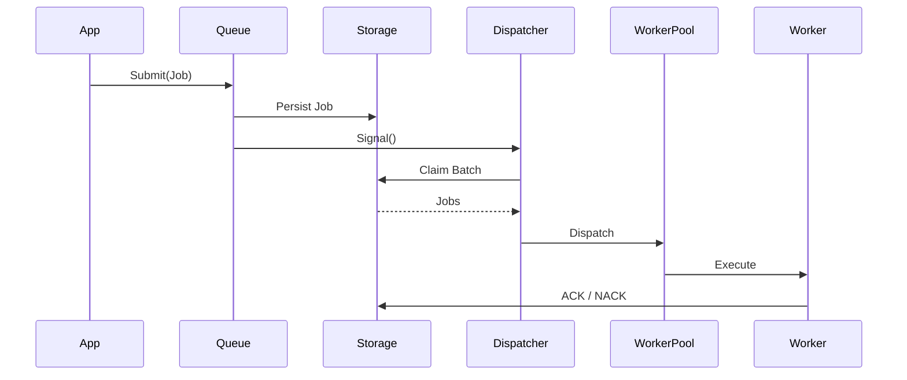

---

# Schedule Lifecycle

Schedules are persistent entities.

An upsert operation either creates or updates a schedule definition.

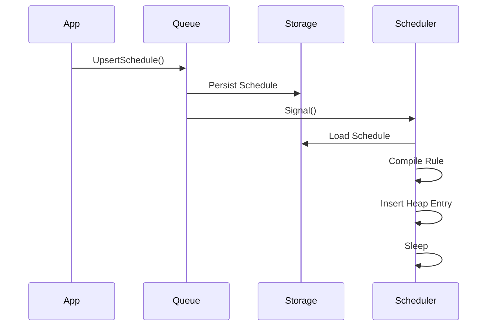

---

# Schedule Execution Lifecycle

Due schedules fire in batches (up to `FireBatch`):

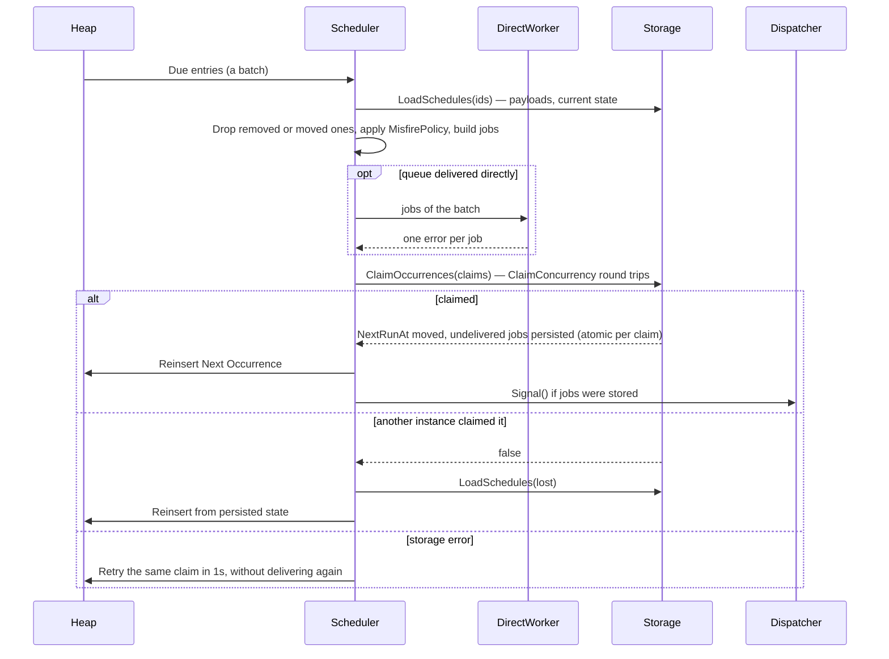

Each claim is a compare-and-swap on the schedule's persisted
`NextRunAt`: it only succeeds while the schedule is active and
`NextRunAt` still holds the occurrence being fired. Because its
jobs are written in the same operation, an occurrence is
generated exactly once even with several instances, and a crash
cannot lose it between "advance" and "persist". Batching only
saves round trips: claims succeed or fail one by one.

An occurrence delivered directly is claimed with no job: the
claim counts it (`Generated`) towards `MaxJobs`. If the claim
then fails to be written, the scheduler retries that same claim
without delivering again; if the process dies first, the
occurrence is delivered again when it fires on restart, which
is why direct delivery must be idempotent.

---

# Schedule Update Flow

Updating an existing schedule rebuilds its runtime representation.

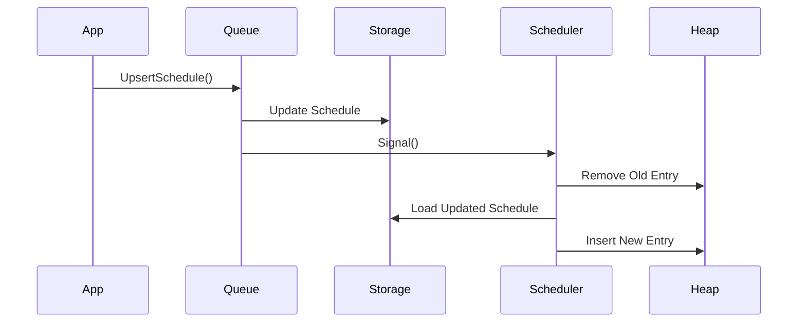

---

# Schedule Removal Flow

Removing a schedule stops future job generation. The record
is kept with status `cancelled`, as history and as a
tombstone (see Versioned upserts).

Already-created jobs remain unaffected.

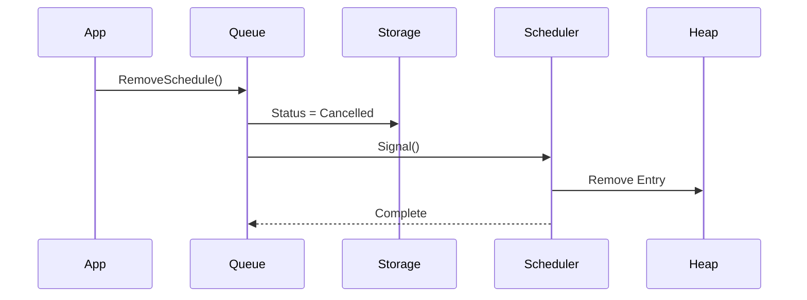

---

# Schedule Pause Flow

Paused schedules remain persisted but stop generating jobs.

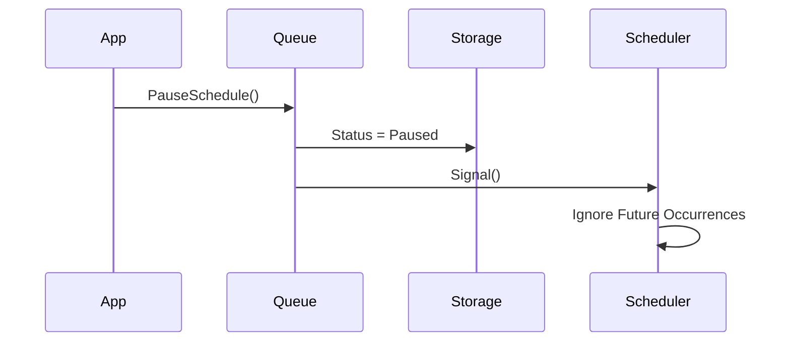

---

# Schedule Resume Flow

Resuming a schedule recalculates its next occurrence.

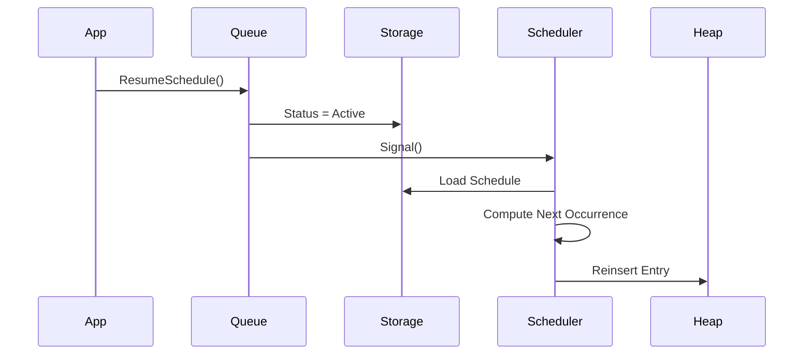

---

# Queue Pause Flow

Queue pause affects job execution only. The paused set is
persisted, so every instance sharing the storage honours it.

Schedules may continue advancing internally, depending on policy.

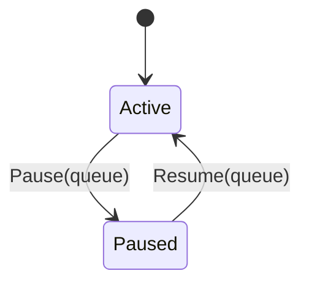

During pause:

```text
Scheduler        -> Active
Storage          -> Active
Dispatcher       -> Stopped
Worker Pool      -> Stopped
```

No jobs are executed.

---

# Scheduler Internal Model

The scheduler stores only the minimum information necessary for
ordering, without the payload (about 320 bytes per schedule,
compiled rule included; time zones are shared):

```go
type HeapEntry struct {
	ScheduleID    string
	JobName       string
	Queue         QueueName
	Priority      int
	MisfirePolicy domain.MisfirePolicy

	NextRunNanos int64 // when to fire
	ClaimNanos   int64 // persisted NextRunAt the claim expects

	MaxJobs, GeneratedJobs int
	UpdatedAt time.Time   // revision the entry was built from
	compiled  CompiledSchedule
	pending   *storage.Claim // a claim whose write failed, retried as is
}
```

The heap is not a cache.

It is merely a temporal execution index of a window of time:

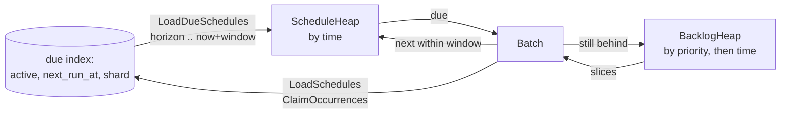

- Every half window the window is extended: only schedules due
  between the old horizon and now+window are loaded. Every 20
  extensions, after a load truncated at `ScheduleWindowLimit`
  (once the heap drains), or when the owned shards change, it is
  reloaded in full. A next occurrence past the window is dropped
  from memory and comes back with a later load.
- An entry is checked against the stored schedule when it
  fires: a schedule removed, paused or claimed elsewhere does not
  fire, and one changed since it was loaded is recompiled.
- A catch-up schedule generates at most `CatchUpBatch` jobs per
  claim. If it is still behind, the claim persists the first
  occurrence not yet generated as `NextRunAt`, and the entry
  moves to the backlog. Due entries go first, and the backlog
  gets slices after every few of them (`backlogEvery`), so
  replaying a backlog delays on-time occurrences by at most one
  batch, and on-time load cannot starve a backlog. A batch takes
  backlog slices of one priority only, so a less important
  backlog waits for the more important ones.

The heap stays a binary heap: popping and pushing an entry
costs about 2.5 µs with a million entries, and the scheduler
fires about 400,000 occurrences per second against the memory
store, so storage round trips, not the heap, bound throughput.

---

# Scheduler State Machine

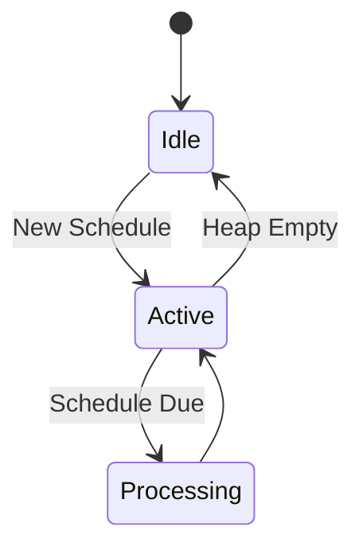

---

# Worker Registration

Workers are registered by queue.

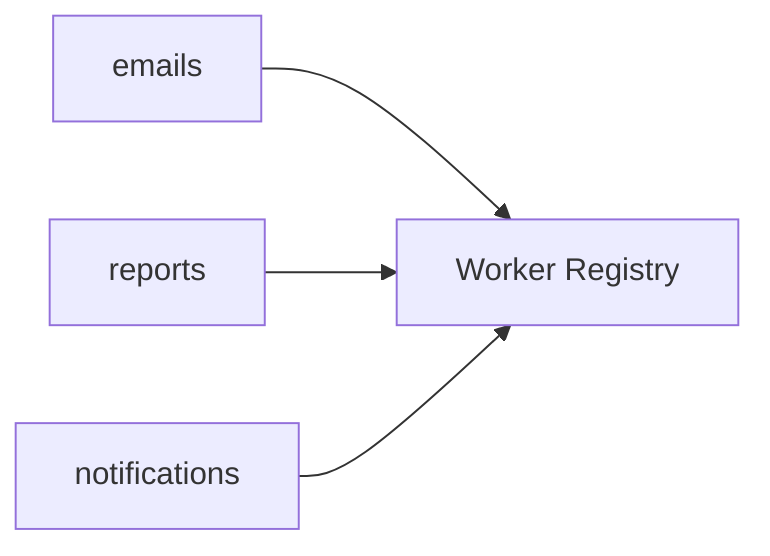

Example:

```go
queue.Handle("emails", EmailWorker{})
queue.Handle("reports", ReportWorker{})
```

---

# Elastic Worker Pool

Workers are dynamically created and destroyed according to workload.

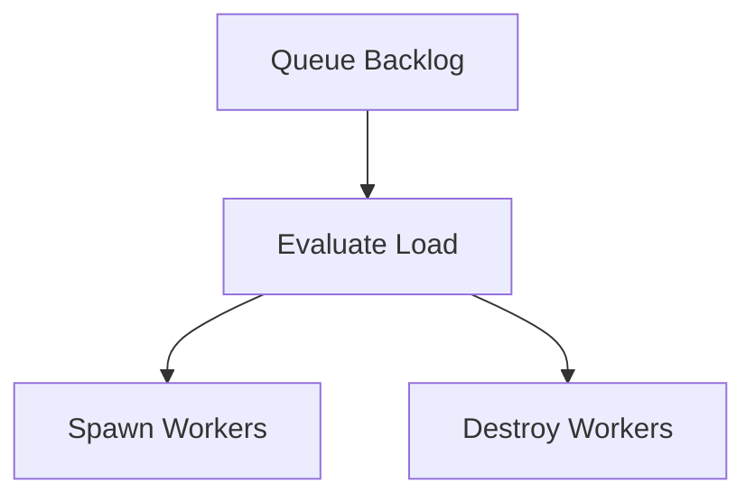

Inputs used for scaling:

- Pending jobs
- Processing jobs
- Queue backlog
- Average processing latency
- Throughput

---

# Worker Pool State Machine

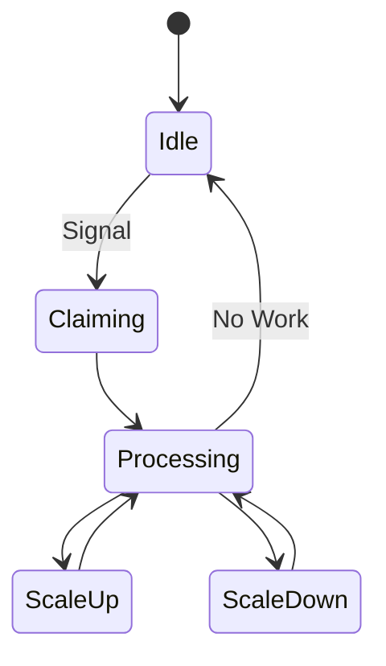

---

# Job Claiming

Workers never claim jobs directly.

The Dispatcher owns job acquisition.

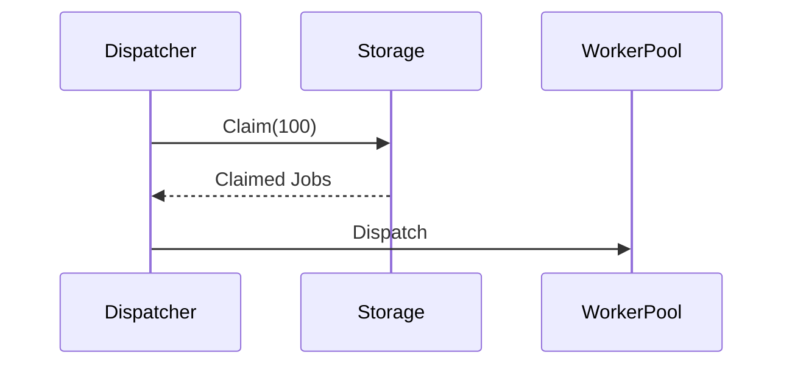

Batch claiming dramatically reduces storage round trips.

---

# Job Leasing

A lease grants temporary ownership.

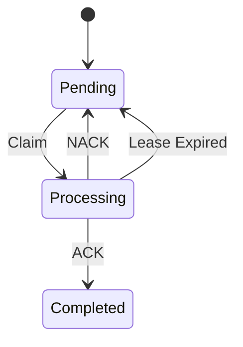

Example:

```go
type Lease struct {
	WorkerID string
	ExpiresAt time.Time
}
```

---

# Recovery Flow

Recovery runs at startup and, when `SyncInterval` is set,
periodically (see Running several instances).

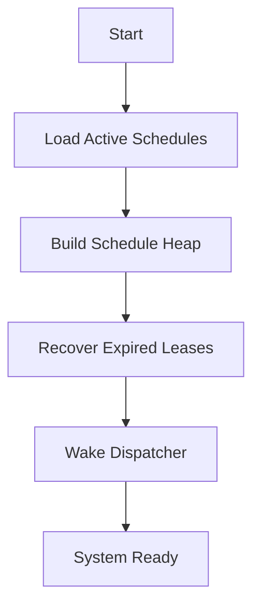

---

# Idle-First Runtime Model

The entire system is designed around sleeping actors.


This applies equally to:

- Scheduler
- Dispatcher
- Worker Pool

When no jobs or schedules are due, hydra consumes effectively zero scheduling CPU. The only storage query it makes is extending the scheduler's time window, one indexed query every half window (30s by default). That load is what keeps memory bounded when there are many schedules.

# Edge Cases

## Worker Crash

Scenario:

```text
Job claimed
Worker crashes
```

Expected behavior:

- Job becomes claimable again
- Retry policy is respected

---

## Long Running Jobs

Scenario:

```text
Job execution exceeds normal duration
```

Expected behavior:

- Lease remains valid: while a handler runs, its lease is
  extended every `LeaseTTL/3`
- Job is not duplicated

---

## Scheduler Downtime

Scenario:

```text
Scheduler offline
```

Expected behavior:

- Missed schedules are handled according to MisfirePolicy.
  The next occurrence is persisted, so on restart the
  scheduler resumes from it instead of from "now".
- CatchUp replays in ordered batches, time sliced with on-time
  occurrences and ordered by Priority across schedules (see
  Scheduler Internal Model). Its position is persisted after
  every batch.

Policies:

- Skip
- RunOnce
- CatchUp

---

## Retry Overflow

Scenario:

```text
Exponential backoff grows indefinitely
```

Expected behavior:

- Delay is capped

---

## Dead Letter

Scenario:

```text
Max attempts exceeded
```

Expected behavior:

- Job moves to dead letter state

---

# Versioned upserts

A schedule may carry a `Version` (for the broker bridge, when
the stream stored the message that defined it, in nanoseconds:
unlike the sequence, it keeps growing when a stream is
recreated). When non-zero,
saving a schedule whose version is not greater than the stored
one fails with `ErrStaleVersion` and changes nothing.

Cancellations are versioned tombstones (status `cancelled`),
not deletions. Together this makes the outcome independent of
processing order: a cancellation processed before its
definition, or an old update processed after a newer one, is
rejected instead of reviving or overwriting the schedule.

Re-upserting an unchanged rule keeps the schedule's progress
(`GeneratedJobs`, `NextRunAt`), so a redelivered definition
does not restart it.

The broker bridge builds a lifecycle on top (see Broker
scheduler mode): creates are idempotent by fingerprint, a
replacement archives the current revision under
`<id>#<revision>` (status `archived`) before writing the new
one, and every revision and state change records a trace id.

---

# Running several instances

Several instances may share a Redis (Valkey, Dragonfly) or
PostgreSQL storage.

- Each occurrence is claimed atomically (`ClaimOccurrences`).
- Jobs are claimed with leases; a crashed instance's leases
  expire and are recovered by the others.
- With `SyncInterval > 0`, every instance periodically loads
  the schedules of its window changed elsewhere since its last
  sync (`DueQuery.ChangedSince`), recovers expired leases,
  refreshes paused queues and wakes its dispatcher for jobs
  submitted by others. Correctness does not depend on it; it
  only bounds how long an instance takes to notice that work.

With `SyncInterval = 0` (the default), hydra stays fully
idle-first and assumes a single instance.

Instances split the schedules into 256 shards
(`domain.ScheduleShard`, a stable hash of the id):

- Every sync, an instance renews its heartbeat
  (`Storage.Heartbeat`) and receives the live members. Each
  shard belongs to the member with the highest rendezvous hash
  for it (`domain.OwnedShards`), so a join or leave moves only
  the shards that member gains or loses, about 1/n.
- A clean stop leaves the membership at once. A crash is
  noticed when the heartbeat expires (3 × `SyncInterval`).
- During a membership change, two instances may briefly own a
  shard, or none may. Overlap is harmless because claims are
  atomic. A shard owned by none is taken at the next sync, and
  the misfire policy covers the delay.
- A schedule registered on a non-owner instance fires there
  once, then its owner takes over. A new schedule therefore
  never waits for the owner's next sync.

---

# Broker scheduler mode

`cmd/hydra-scheduler` makes hydra the scheduler of NATS
JetStream streams. It is built from the scheduler alone
(package `scheduling`), the `bridge` and the NATS adapter: no
job queue, worker pool or dead letters, and only schedules in
the store.

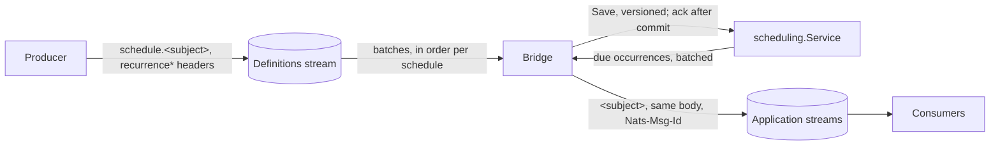

- The wire contract (docs/CONTRACT.md, package `contract`) is
  CloudEvents 1.0 in binary mode. The recurrence is read from
  headers only; the body is stored and republished byte for
  byte. Messages without recurrence are acknowledged and
  ignored.
- Definitions are published under a subject prefix
  (`schedule.`) and occurrences on the subject without it, so
  consumers never see definitions and the scheduler never
  reads its own occurrences.
- The NATS adapter consumes several streams, each through the
  subject filters that belong to it, and checks that each
  consumer still exists: one deleted, or whose stream was
  recreated, is created again (from the start of a work queue
  or a new stream, otherwise from when it was last seen), and hands messages to
  workers by schedule key, so the changes of one schedule are
  processed in order. Each key slot has its queue; its worker
  starts with the first message and stops after 30 s idle,
  never two at once. A worker takes what is waiting, up to a
  batch, and the bridge applies the batch in memory and saves
  every schedule it changed in one `SaveSchedules`. Messages
  are acknowledged after the commit.
- Due occurrences are delivered (asynchronous publishes) and
  claimed only once JetStream acknowledged them. Their headers
  are stored once per definition as a template, decoded per
  occurrence into one map without copying keys or values; the
  firings and jobs of a batch are allocated together. A failed one is
  delivered again with exponential backoff; its schedule does
  not advance meanwhile. The published id is deterministic per
  occurrence, so the broker drops a repeat within its window.
- Consumers tell occurrences (`ce-hydraschedule`) from
  definitions (`ce-recurrence*`) by headers.

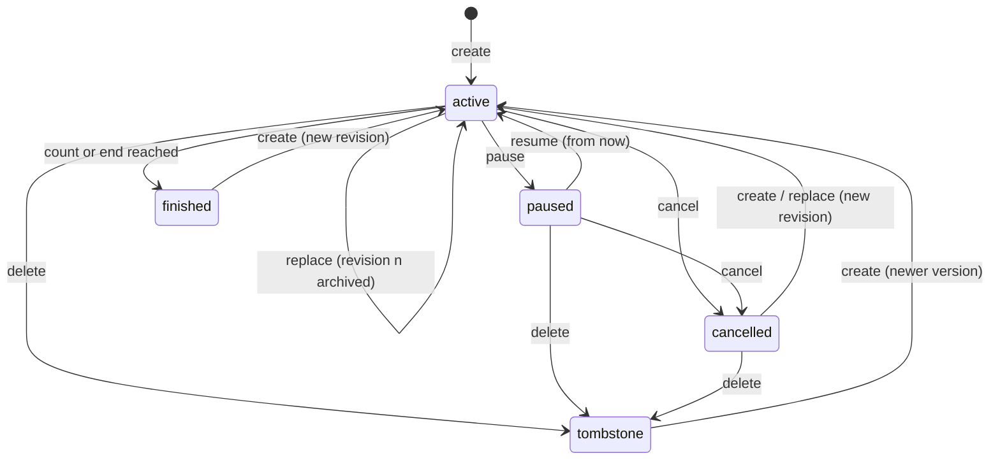

---

# Observability

Broker-side figures (consumer lag, redeliveries, stream rates)
come from the broker's own monitoring, e.g. NATS `/jsz` and
`prometheus-nats-exporter`. `hydra-scheduler` exposes what only
hydra knows on an optional internal port (`HYDRA_HTTP_ADDR`):

- `/healthz`: process alive.
- `/readyz`: broker connected and store reachable.
- `/metrics`: messages ignored; definitions by action
  (registered, replaced, duplicate, conflict, paused, resumed,
  cancelled, deleted, unknown, stale, invalid); occurrences
  published, publish errors, retries and lateness; stalled
  schedules; occurrences claimed and claims lost; schedules in
  memory, catch-up backlog and shards owned.

Logs are structured (`log/slog`, JSON by default).

---

# Non Goals

hydra intentionally does not provide:

- Workflow engines
- DAG execution
- Event sourcing
- Distributed coordination
- Cross-cluster consensus
- Message broadcasting

hydra is a background job processing library, not a distributed workflow platform.
