# Hydra Architecture

## Overview

Hydra is a persistent job processing system built around three independent runtime subsystems:

1. **Storage** — the source of truth.
2. **Scheduler** — transforms recurring schedules into executable jobs.
3. **Worker Pool** — executes jobs.

The Queue API acts as the single public entry point and coordinates all interactions between these components.

Both the Scheduler and Worker Pool are designed as **idle-first actors**. They remain dormant when no work exists and are activated through lightweight signals whenever new work arrives.

# Core Components

## Queue

The Queue acts as a facade.

Responsibilities:

- Accept jobs.
- Accept recurring schedules.
- Register workers.
- Control queue lifecycle.
- Expose metrics and statistics.

The Queue never executes jobs directly.

---

## Storage

Storage is the system of record.

Responsibilities:

- Persist jobs.
- Persist schedules.
- Persist execution state.
- Persist leases.
- Support crash recovery.

Supported implementations may include:

- Memory (only for testing)
- SQLite (default)
- Redis/Valkey
- PostgreSQL (soon)
- MySQL (soon)

All runtime state can be reconstructed from storage.

---

## Scheduler

The Scheduler transforms schedules into executable jobs.

Responsibilities:

- Track upcoming schedule occurrences.
- Generate jobs.
- Update schedule state.
- Reinsert recurring schedules.

The Scheduler never executes jobs.

The Scheduler never holds full schedule objects in memory.

---

## Dispatcher

The Dispatcher bridges storage and workers.

Responsibilities:

- Claim jobs.
- Acquire leases.
- Batch loading.
- Recover expired leases.
- Feed jobs into worker pools.

The Dispatcher is responsible for ownership and locking.

---

## Worker Pool

The Worker Pool executes jobs.

Responsibilities:

- Receive claimed jobs.
- Execute handlers.
- ACK completed jobs.
- NACK failed jobs.
- Scale worker count.

The Worker Pool never performs scheduling.

---

# Public API

```go
type Producer interface {
	Submit(
		ctx context.Context,
		queue QueueName,
		job Job,
	) error

	RemoveJob(
		ctx context.Context,
		queue QueueName,
		jobID string,
	) error

	UpsertSchedule(
		ctx context.Context,
		queue QueueName,
		schedule Schedule,
	) error

	RemoveSchedule(
		ctx context.Context,
		queue QueueName,
		scheduleID string,
	) error

	PauseSchedule(
		ctx context.Context,
		queue QueueName,
		scheduleID string,
	) error

	ResumeSchedule(
		ctx context.Context,
		queue QueueName,
		scheduleID string,
	) error
}

type Consumer interface {
	Handle(queue QueueName, worker Worker)
}

type Queue interface {
	Producer
	Consumer

	Start(ctx context.Context) error
	Stop(ctx context.Context) error

	Pause(ctx context.Context, queue QueueName) error
	Resume(ctx context.Context, queue QueueName) error

	Stats(ctx context.Context) (StatsSnapshot, error)
}
```

---

# High-Level Architecture

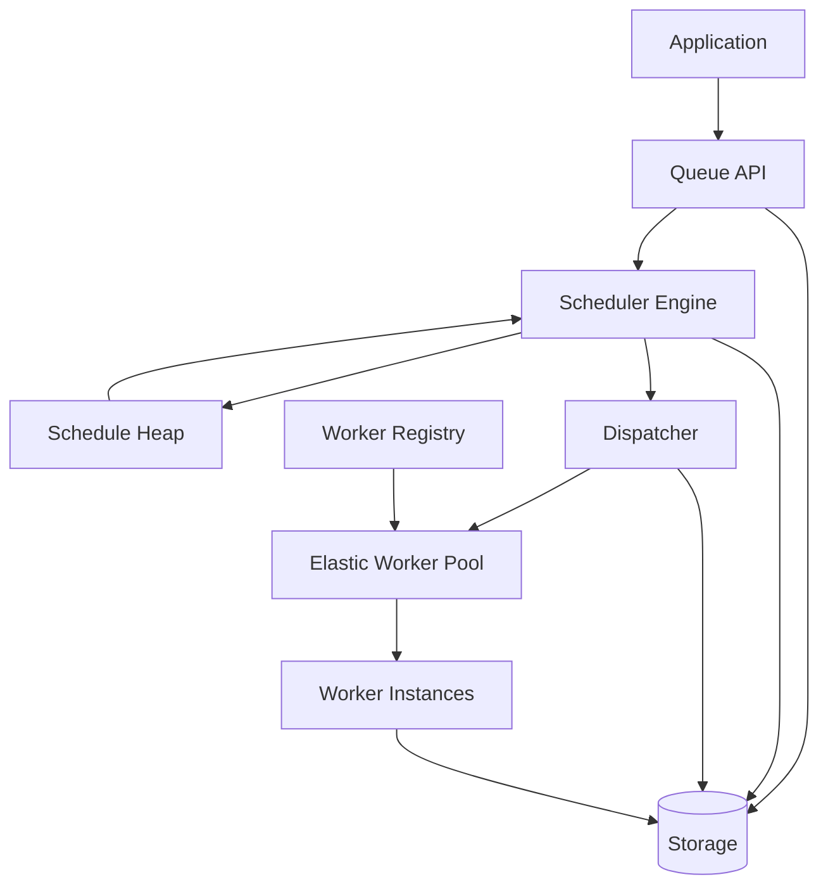

---

# Job Lifecycle

Direct jobs bypass the scheduler entirely.

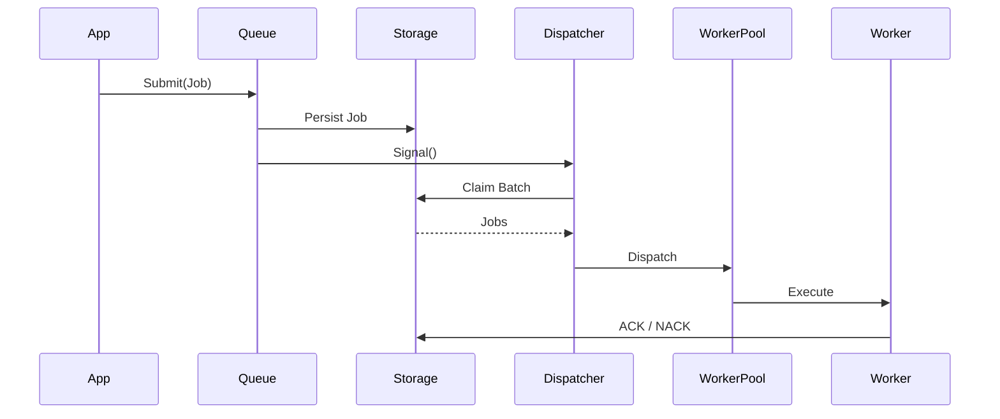

---

# Schedule Lifecycle

Schedules are persistent entities.

An upsert operation either creates or updates a schedule definition.

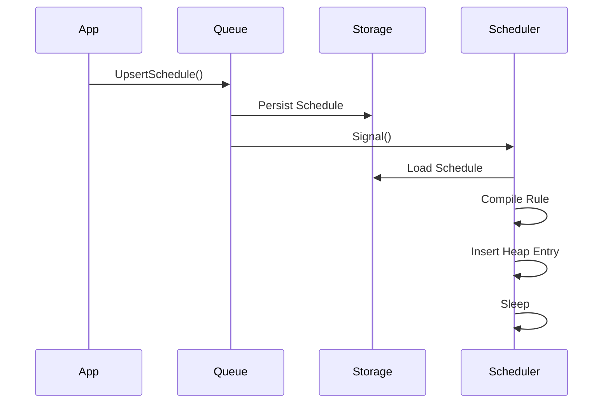

---

# Schedule Execution Lifecycle

When a scheduled occurrence becomes due:

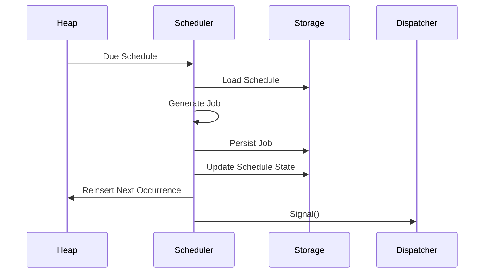

---

# Schedule Update Flow

Updating an existing schedule rebuilds its runtime representation.

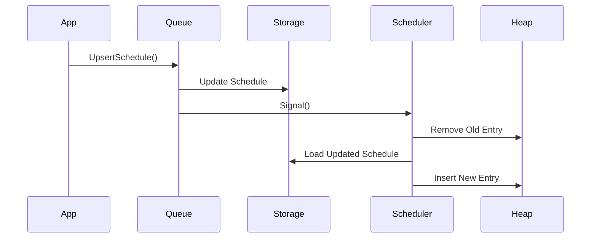

---

# Schedule Removal Flow

Removing a schedule permanently stops future job generation.

Already-created jobs remain unaffected.


---

# Schedule Pause Flow

Paused schedules remain persisted but stop generating jobs.

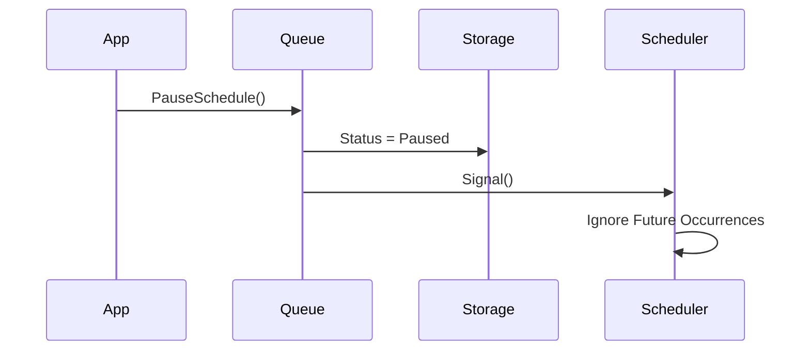

---

# Schedule Resume Flow

Resuming a schedule recalculates its next occurrence.

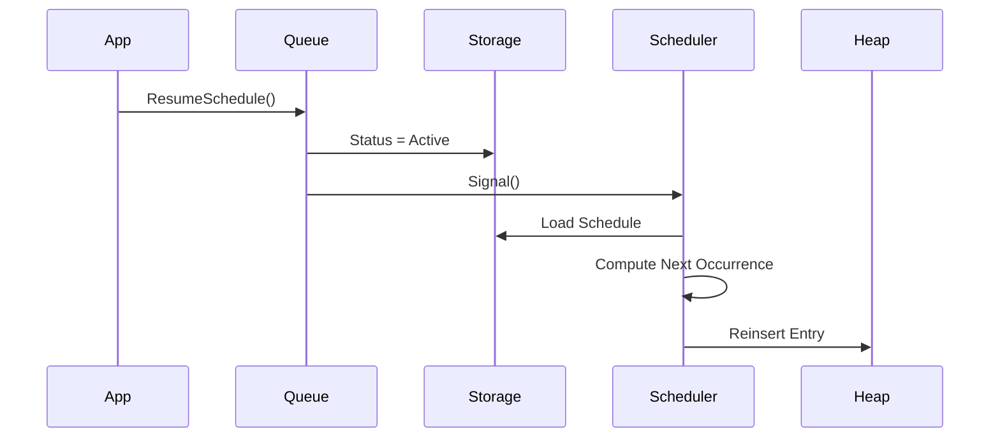

---

# Queue Pause Flow

Queue pause affects job execution only.

Schedules may continue advancing internally, depending on policy.

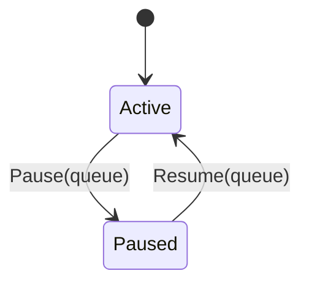

During pause:

```text
Scheduler        -> Active
Storage          -> Active
Dispatcher       -> Stopped
Worker Pool      -> Stopped
```

No jobs are executed.

---

# Scheduler Internal Model

The scheduler stores only the minimum information necessary for ordering.

```go
type HeapEntry struct {
	ScheduleID string

	NextRunMillis int64
}
```

The heap is not a cache.

It is merely a temporal execution index.

---

# Scheduler State Machine

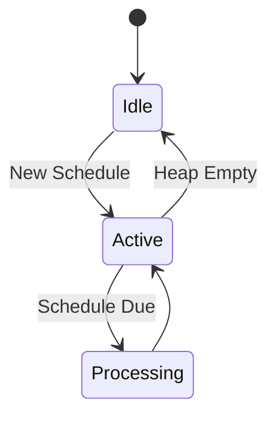

---

# Worker Registration

Workers are registered by queue.

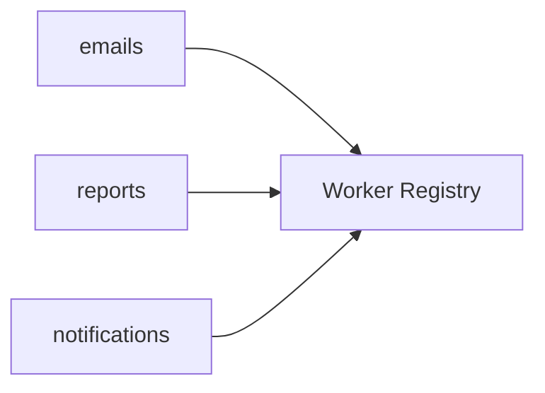

Example:

```go
queue.Handle("emails", EmailWorker{})
queue.Handle("reports", ReportWorker{})
```

---

# Elastic Worker Pool

Workers are dynamically created and destroyed according to workload.

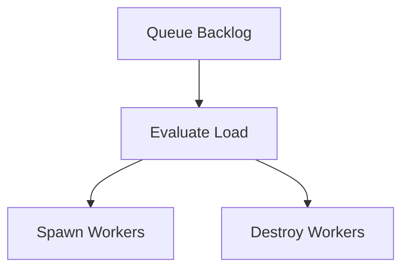

Inputs used for scaling:

- Pending jobs
- Processing jobs
- Queue backlog
- Average processing latency
- Throughput

---

# Worker Pool State Machine

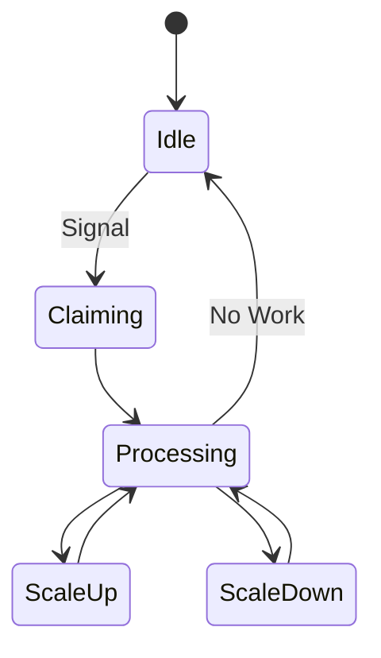

---

# Job Claiming

Workers never claim jobs directly.

The Dispatcher owns job acquisition.

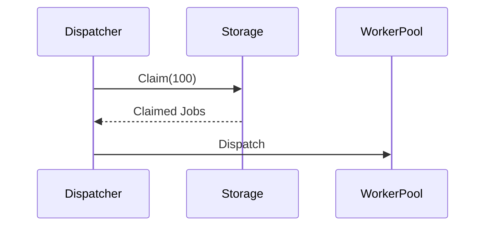

Batch claiming dramatically reduces storage round trips.

---

# Job Leasing

A lease grants temporary ownership.

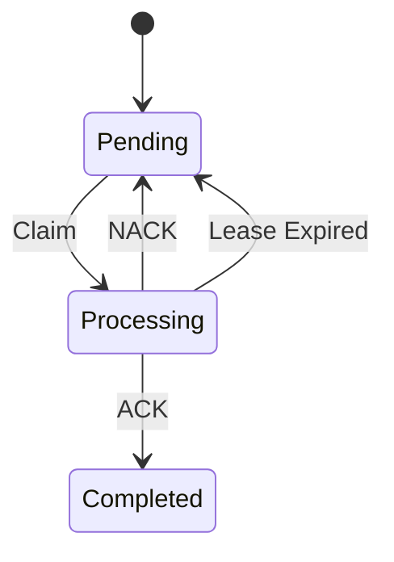

Example:

```go
type Lease struct {
	WorkerID string
	ExpiresAt time.Time
}
```

---

# Recovery Flow

Recovery only occurs during startup.

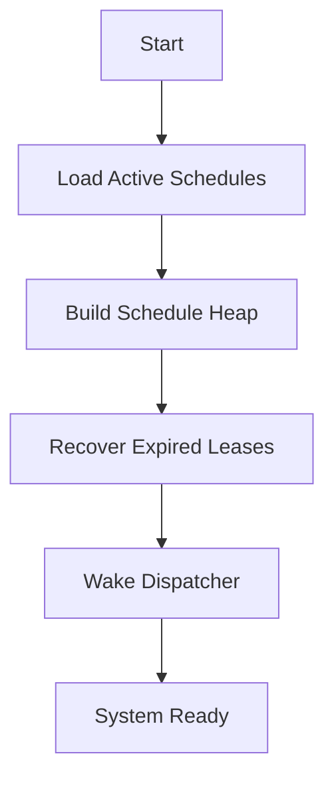

---

# Idle-First Runtime Model

The entire system is designed around sleeping actors.

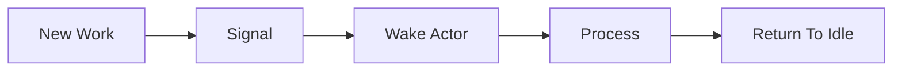

This applies equally to:

- Scheduler
- Dispatcher
- Worker Pool

When no jobs or schedules exist, hydra consumes effectively zero scheduling CPU and performs no storage polling.

# Edge Cases

## Worker Crash

Scenario:

```text
Job claimed
Worker crashes
```

Expected behavior:

- Job becomes claimable again
- Retry policy is respected

---

## Long Running Jobs

Scenario:

```text
Job execution exceeds normal duration
```

Expected behavior:

- Lease remains valid
- Job is not duplicated

---

## Scheduler Downtime

Scenario:

```text
Scheduler offline
```

Expected behavior:

- Missed schedules are handled according to MisfirePolicy

Policies:

- Skip
- RunOnce
- CatchUp

---

## Retry Overflow

Scenario:

```text
Exponential backoff grows indefinitely
```

Expected behavior:

- Delay is capped

---

## Dead Letter

Scenario:

```text
Max attempts exceeded
```

Expected behavior:

- Job moves to dead letter state

---

# Non Goals

hydra intentionally does not provide:

- Workflow engines
- DAG execution
- Event sourcing
- Distributed coordination
- Cross-cluster consensus
- Message broadcasting

hydra is a background job processing library, not a distributed workflow platform.
